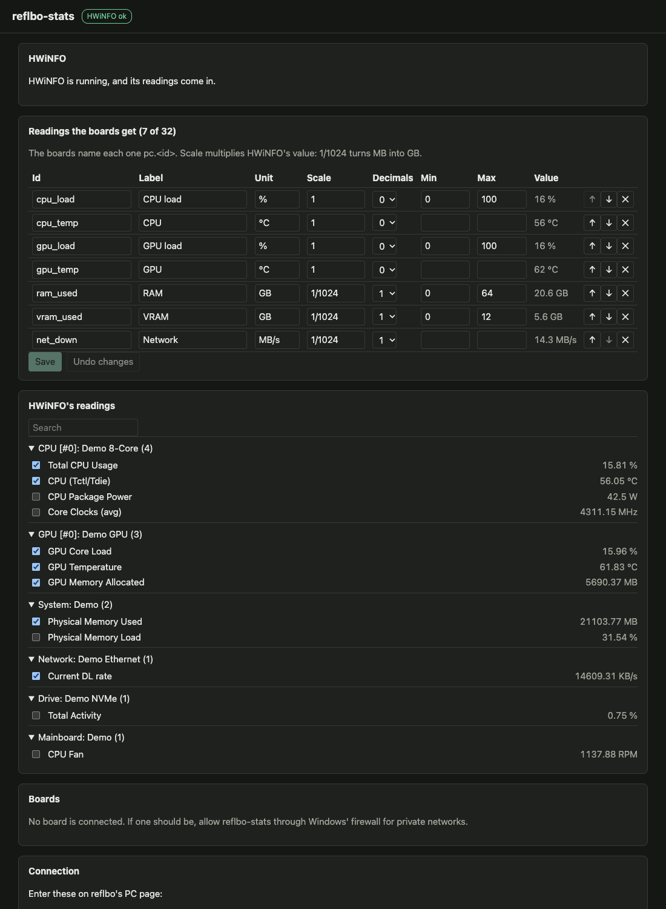

# reflbo-stats

A small Windows tray app that serves this PC's sensors, as [HWiNFO](https://www.hwinfo.com) measures them, to [reflbo](https://github.com/Vybo/reflbo) desk displays on your home network. While the PC is on, a reflbo board can show its CPU and GPU load and temperatures, memory and network as numbers, history charts, bars and gauges. When the PC sleeps, the board goes back to its usual dashboards.

<p></p>

## What you need

- Windows 10 or 11, 64-bit.
- **HWiNFO Pro**, running with **Shared Memory Support** on (HWiNFO ▸ Settings ▸ Shared Memory Support). Sensors-only mode is enough. The free HWiNFO switches shared memory off after 12 hours.
- A reflbo board with firmware M7 or later, on the same network.

## Install and first start

1. Download `reflbo-stats.exe` and put it where it can stay, for example `C:\Tools\reflbo-stats\`.
2. Run it. The file isn't signed, so Windows SmartScreen may warn the first time: choose **More info ▸ Run anyway**.
3. Windows' firewall asks whether reflbo-stats may use the network. Allow it for **private networks**: the boards connect to it. If Windows has your home network marked Public, mark it Private (Settings ▸ Network & internet ▸ your network ▸ Private), or allow the app for public networks too.
4. The settings page opens in your browser (`http://127.0.0.1:47124/`). Tick the readings you want the boards to have, adjust them, and **Save**.
5. On reflbo's web page, open **PC** and enter the address, port and token the settings page shows under **Connection**.

The board looks for the PC at each sync. When it finds it, it can switch to sync mode Always on and to its PC preset; both are options on its PC page.

## The tray

- **Left-click:** opens the settings page.
- **Right-click:**
  - **Open settings**;
  - **Start with Windows**, which starts the app after you log in (off at first);
  - **Quit**, which tells the boards at once, so they return to their dashboards without waiting.
- **The icon:** a mark appears while HWiNFO isn't delivering readings, and a dot while a board is connected.

## The readings

Each picked reading has:

- **Id:** how the board's presets name it, as `pc.<id>`: a-z, 0-9 and _, up to 15 characters. Renaming it means updating the presets that use it.
- **Label** and **unit:** what the board shows, up to 23 and 7 bytes.
- **Scale:** multiplies HWiNFO's value. `1/1024` turns MB into GB, and the unit follows it.
- **Decimals:** 0 to 3.
- **Min** and **max:** the usual range, where the board's bars, rings and gauges start. A % runs 0–100 unless you change it; leave both empty for an automatic chart.

Up to 32 readings. The board's PC preset fills its charts and bars from the first ones in the list, so put the ones you want there at the top.

## When something isn't right

| The page says | What to do |
|---|---|
| HWiNFO isn't running | Start HWiNFO with Shared Memory Support on |
| Shared Memory Support is off | Turn it on in HWiNFO's Settings |
| HWiNFO has stopped updating | HWiNFO is paused, or the free version's 12 hours are up |
| No board is connected | Check the address, port and token on reflbo's PC page, and that the firewall allows reflbo-stats on private networks |
| The boards can't reach this PC | Another program holds the LAN port: choose another under App and Apply, then enter it on reflbo's PC page |

The settings and a log live in `%APPDATA%\reflbo-stats\` (`config.json`, `log.txt`). **New token**, under Connection, disconnects every board until it gets the new one.

## For developers

```sh
go test ./... && node --test test/web/app.test.mjs   # on any system
go run ./cmd/reflbo-stats -demo -no-tray             # a plausible PC, served on this machine
scripts/build.sh                                     # dist/reflbo-stats.exe, cross-compiled
reflbo-stats.exe -dump hwinfo.bin                    # on the PC: HWiNFO's shared memory for the tests (log.txt says how it went)
```

[AGENTS.md](AGENTS.md) has the details; [docs/spec.md](docs/spec.md) the design. The protocol is reflbo's: its design spec, §12a.

## Licence

GPL-3.0-only: see [LICENSE](LICENSE) and [NOTICE](NOTICE). Versions up to commit `fef9fa7` were released under Apache-2.0.
